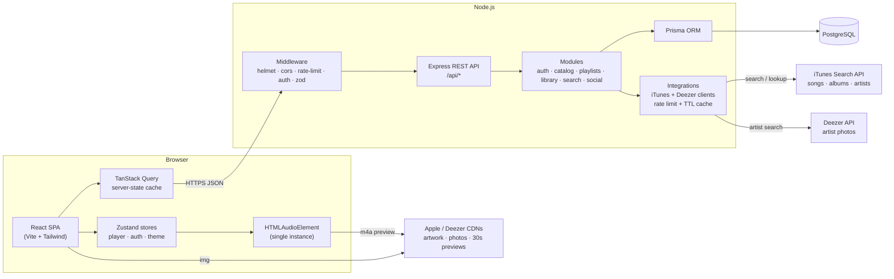
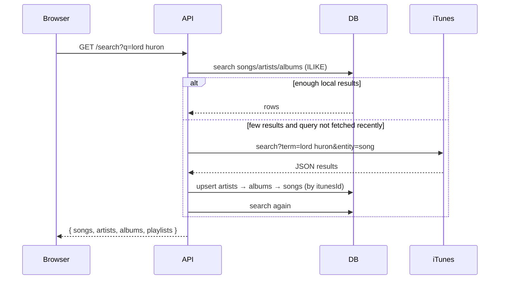
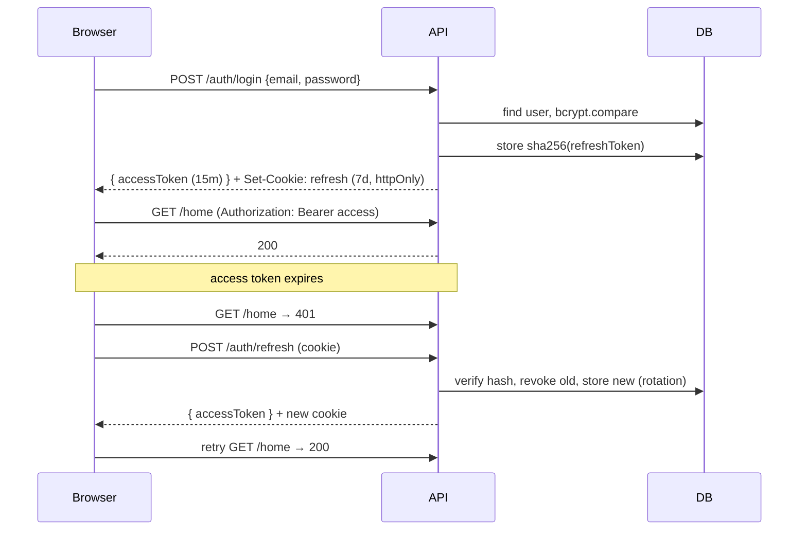

# System Design — Muse

Muse is a music streaming web app (Spotify-like) built as a monorepo with a
React SPA frontend and a REST API backend backed by PostgreSQL. The music
catalog (songs, albums, artists, artwork and 30-second previews) comes from the
**iTunes Search API**, artist photos come from the **Deezer API**, and both are
cached in our own database.

## 1. Requirements

### Functional
- Register / log in / log out, stay logged in across reloads.
- Home feed: featured banners, curated playlists, recently played, new releases.
- Browse & search songs, artists, albums and playlists. Queries that are not in
  our database yet are fetched from iTunes and cached.
- Play 30-second previews with a persistent player: play/pause, next/prev, seek,
  volume, shuffle, repeat, queue ("Up Next").
- Like songs, create playlists, add/remove songs to playlists.
- See what friends are listening to.
- "Open in Apple Music" link for every track (attribution).
- Dark / light theme.

### Non-functional
- **Mobile first**: usable on a 360px screen, scales up to a 3-column desktop layout.
- Playback must not stop while navigating between pages (SPA + global audio element).
- Secure auth (hashed passwords, short-lived access tokens, httpOnly refresh cookie).
- Respect the iTunes rate limit (~20 requests/minute): the browser never calls
  external music APIs directly; the backend caches results.
- Responses for list endpoints < 200 ms when served from the database.

## 2. High-level architecture



**Key ideas**
- Our API serves *metadata* (JSON) from PostgreSQL. Audio previews and images
  are loaded by the browser straight from Apple's and Deezer's CDNs, so the Node
  process never streams media.
- iTunes is the **external source of truth for the catalog**; our database is a
  cache of it plus everything user-specific (likes, playlists, history, follows).

## 3. Tech stack

| Layer      | Choice                                   | Why |
|------------|------------------------------------------|-----|
| Frontend   | React 19, TypeScript, Vite               | Fast DX, typed components |
| Styling    | Tailwind CSS v4                          | Mobile-first utilities, design tokens via CSS variables |
| Routing    | React Router 7                           | Nested layouts (player stays mounted) |
| Server state | TanStack Query                         | Caching, refetching, mutations with invalidation |
| Client state | Zustand                                | Tiny global store for the player queue |
| Backend    | Node.js, Express 5, TypeScript           | Simple, well-known REST stack |
| Validation | Zod                                      | Runtime validation of requests and of external API responses |
| ORM        | Prisma                                   | Type-safe queries, migrations, upserts, seeding |
| Database   | PostgreSQL 16                            | Relational data (users ↔ playlists ↔ songs) |
| Music data | iTunes Search API (+ Deezer API for artist photos) | Free, no API key, real artwork + previews |
| Auth       | JWT access token + rotating refresh token (httpOnly cookie), bcrypt | Stateless requests, revocable sessions |
| Tests / CI | Vitest + Supertest, GitHub Actions       | Automated checks on every push |

## 4. External catalog — iTunes Search API + Deezer

### Endpoints used

| Purpose | Request |
|---|---|
| Search songs | `GET https://itunes.apple.com/search?term={q}&media=music&entity=song&limit=25&country=VN` |
| Album + tracks | `GET https://itunes.apple.com/lookup?id={collectionId}&entity=song` |
| Artist + albums | `GET https://itunes.apple.com/lookup?id={artistId}&entity=album&limit=10` |
| Artist photo | `GET https://api.deezer.com/search/artist?q={name}&limit=1` |

### Field mapping

| Source field | Our column |
|---|---|
| `trackId` | `Song.itunesId` (unique) |
| `trackName` | `Song.title` |
| `previewUrl` | `Song.previewUrl` (30 s, AAC/m4a) |
| `trackTimeMillis` | `Song.durationSec` (full length, ÷ 1000) |
| `trackNumber` | `Song.trackNumber` |
| `primaryGenreName` | `Song.genre` |
| `trackViewUrl` | `Song.externalUrl` ("Open in Apple Music") |
| `artworkUrl100` | `Album.coverUrl` (resized, see below) |
| `collectionId`, `collectionName`, `releaseDate` | `Album.itunesId`, `Album.title`, `Album.releaseDate` |
| `artistId`, `artistName` | `Artist.itunesId`, `Artist.name` |
| Deezer `picture_xl` | `Artist.imageUrl` |

### Images
- Song and album artwork come from `artworkUrl100`; the size is part of the URL,
  so we resize it on the fly (`100x100bb` → `200x200bb` for lists, `600x600bb`
  for cards, `1200x1200bb` for the hero and full-screen player).
- iTunes has no artist photos. When an artist is first imported we look it up on
  the **Deezer API** and store `picture_xl` in `Artist.imageUrl` if the name
  matches; otherwise we fall back to the cover of the artist's latest album.
  The lookup happens once and is cached in the database.

### Read-through cache (search)



- **Upsert by `itunesId`** makes imports idempotent: the same track is never stored twice.
- An in-memory **TTL cache** remembers which search terms were fetched recently
  (e.g. 24 h), and a **request limiter** keeps outgoing calls under ~20/minute.
- External responses are validated with Zod; if iTunes is down or rate-limits
  us, the API still returns local results.
- The seed script imports a curated set of searches (artists and moods) so the
  app has real content on first run.

## 5. Data model

```mermaid
erDiagram
  User ||--o{ Playlist : owns
  User ||--o{ LikedSong : likes
  User ||--o{ PlayHistory : plays
  User ||--o{ RefreshToken : has
  User ||--o{ Follow : "follows (follower)"
  User ||--o{ Follow : "followed by (following)"
  Artist ||--o{ Album : releases
  Artist ||--o{ Song : performs
  Album ||--o{ Song : contains
  Playlist ||--o{ PlaylistSong : has
  Song ||--o{ PlaylistSong : "appears in"
  Song ||--o{ LikedSong : "liked in"
  Song ||--o{ PlayHistory : "played in"
  Playlist ||--o{ Banner : "featured by"

  User { string id PK; string email UK; string passwordHash; string displayName; string avatarUrl }
  Artist { string id PK; string itunesId UK; string name; string imageUrl }
  Album { string id PK; string itunesId UK; string title; string coverUrl; datetime releaseDate; string genre; string artistId FK }
  Song { string id PK; string itunesId UK; string title; int durationSec; string previewUrl; string externalUrl; string genre; int trackNumber; int playCount; string artistId FK; string albumId FK }
  Playlist { string id PK; string name; string description; string coverUrl; bool isCurated; bool isPublic; string ownerId FK }
  PlaylistSong { string playlistId PK; string songId PK; int position; datetime addedAt }
  LikedSong { string userId PK; string songId PK; datetime createdAt }
  PlayHistory { string id PK; string userId FK; string songId FK; datetime playedAt }
  Follow { string followerId PK; string followingId PK }
  RefreshToken { string id PK; string userId FK; string tokenHash UK; datetime expiresAt; datetime revokedAt }
  Banner { string id PK; string eyebrow; string title; string subtitle; string imageUrl; string playlistId FK; int sortOrder }
```

Notes
- Our own primary keys (`cuid`) are used for relations; `itunesId` is a separate
  unique column, stored as text so we never depend on the size of Apple's ids.
- Join tables (`PlaylistSong`, `LikedSong`, `Follow`) use **composite primary keys**,
  which also prevents duplicates (a song can't be liked twice).
- `PlaylistSong.position` keeps the user-defined order.
- Indexes: `PlayHistory(userId, playedAt DESC)` for "recently played" and
  friends activity; `Song(title)`, `Artist(name)` for search.
- Curated playlists are owned by a system user and flagged with `isCurated`.

## 6. API design (REST, JSON, prefix `/api`)

| Method | Path | Auth | Description |
|--------|------|------|-------------|
| POST | `/auth/register` | – | Create account, returns access token + sets refresh cookie |
| POST | `/auth/login` | – | Log in |
| POST | `/auth/refresh` | cookie | Rotate refresh token, return new access token |
| POST | `/auth/logout` | cookie | Revoke refresh token |
| GET | `/auth/me` | ✓ | Current user |
| GET | `/home` | ✓ | Banners, curated playlists, recently played, new releases |
| GET | `/songs` | ✓ | List songs (`?limit=&cursor=`) |
| GET | `/albums` · `/albums/:id` | ✓ | Albums / album detail with tracks (tracks imported from iTunes on first visit) |
| GET | `/artists/:id` | ✓ | Artist with popular songs and albums |
| GET | `/playlists/:id` | ✓ | Playlist with tracks |
| POST | `/playlists` | ✓ | Create playlist |
| PATCH / DELETE | `/playlists/:id` | owner | Rename / delete |
| POST | `/playlists/:id/songs` | owner | Add song |
| DELETE | `/playlists/:id/songs/:songId` | owner | Remove song |
| GET | `/me/playlists` | ✓ | My playlists (sidebar) |
| GET | `/me/likes` | ✓ | Liked songs |
| GET | `/me/likes/ids` | ✓ | Liked song ids (to render hearts quickly) |
| PUT / DELETE | `/me/likes/:songId` | ✓ | Like / unlike (idempotent) |
| POST | `/me/history` | ✓ | Record a play |
| GET | `/me/friends-activity` | ✓ | Latest track of each followed user |
| GET | `/search?q=` | ✓ | Local search, falls back to iTunes (read-through cache) |
| GET | `/health` | – | Liveness probe |

Errors use one shape: `{ "error": { "message": string, "details"?: unknown } }`
with proper status codes (400 validation, 401 auth, 403 forbidden, 404, 409 conflict,
502 when iTunes fails and there is nothing cached).

## 7. Authentication flow



- The access token lives **only in memory** (not localStorage) → not readable
  by injected scripts after reload; the refresh cookie is `httpOnly`, `sameSite`.
- Refresh tokens are stored **hashed** and **rotated** on every use, so a
  stolen token can be revoked and reuse is detectable.
- Auth endpoints are rate-limited to slow down brute force.

## 8. Frontend architecture

```
App
└─ AppLayout                         (stays mounted → music keeps playing)
   ├─ Sidebar           lg+          nav + my playlists
   ├─ TopBar                         search, theme toggle, avatar
   ├─ <Outlet/>                      Home · Search · Library · Playlist · Album · Artist · Liked
   ├─ NowPlayingPanel   xl+          current track, Up Next, friends activity
   ├─ PlayerBar         lg+          full controls
   ├─ MiniPlayer        < lg         compact player above the tab bar
   ├─ FullPlayer        < lg         full-screen sheet when tapping MiniPlayer
   └─ BottomNav         < lg         Home · Search · Radio · Library
```

**Responsive strategy (mobile first)** — base styles target phones; `md:` adds
more grid columns; `lg:` swaps BottomNav/MiniPlayer for Sidebar/PlayerBar;
`xl:` adds the right "Now Playing" panel — exactly the layout of the design.

**Player engine** — one `Audio` instance lives in the player store module
(`store/player.ts`). The Zustand store owns the queue, index, shuffle/repeat and
volume, and drives the audio element; audio events (`timeupdate`, `ended`) write
back into the store. Any component can call `playQueue(songs, index)`.
Tracks are 30-second previews, so the UI labels them as previews and links to
Apple Music for the full song.

**Server state** — every API resource is a TanStack Query key
(`['home']`, `['playlist', id]`, `['me','likes','ids']`…). Mutations (like, add to
playlist) invalidate the affected keys, likes are updated optimistically.

## 9. Backend structure

```
backend/src
├─ index.ts            start HTTP server
├─ app.ts              express app: middleware + routes
├─ config/env.ts       validated environment variables (zod)
├─ lib/                prisma client, jwt helpers, http errors, dto mappers
├─ integrations/       itunes/ (search, lookup, mapping, upsert) · deezer/ (artist photos)
├─ middleware/         auth guard, validation, error handler
└─ modules/<feature>/  <feature>.routes.ts + <feature>.service.ts
```

Routes handle HTTP (parse/validate, status codes); services hold the business
logic and the Prisma queries; external providers are isolated in `integrations/`
so they can be swapped (e.g. Spotify) without touching the modules.

## 10. Scaling path (beyond the demo)

| Concern | Next step |
|---------|-----------|
| Full-length playback | Licensed provider (Apple MusicKit / Spotify Web Playback SDK) |
| External API limits | Background job queue (BullMQ) for imports, scheduled refresh of popular queries |
| Read-heavy feeds | Redis cache for `/home` and curated playlists, HTTP caching headers |
| Search | PostgreSQL `pg_trgm` / full-text index → Meilisearch/Elasticsearch later |
| Play counts / history | Batch writes through a queue instead of one insert per play |
| Friends activity | WebSocket / SSE push instead of polling |
| API scale | Stateless API → horizontal scaling behind a load balancer; DB read replicas |
| Observability | Structured logs (pino), metrics, error tracking (Sentry) |
